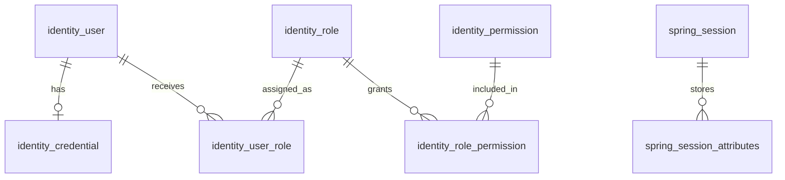

# Auth Database and Server-Side Session Proposal

For the Vietnamese implementation checklist, start with
[Hướng dẫn triển khai auth bằng tiếng Việt](auth-implementation-guide.vi.md).

For the authentication-first staff login slice, see
[Thiết kế DB đăng nhập nhân viên bằng session](staff-authentication-db-design.vi.md).
That slice defers the RBAC tables to authorization without granting business
API access based on authentication alone.

Status: schema proposal, risk R3. The SQL below is a reviewable draft for new
tables, not a registered Flyway migration. It has not been executed. Target JPA
mappings now exist for identity user, credential, and login state, with offline
PostgreSQL metadata/DDL tests. Runtime authentication/session, dependencies, and
databases have not been changed by that mapping work.

This proposal follows `SECURITY.md`, `CODING_STANDARD.md`, and the internal
numeric ID plus public UUID convention in `identity-module-design.md`.

## Ownership and Boundaries

The auth bounded context owns login identities, password credentials, and role
assignments. CIF and staff retain ownership of their business records. Auth
resolves owners through narrow application contracts, not their repositories.

The initial actors are customer and staff identities. Service identities and
partner authentication require their own explicit flows. Provisioning,
credential reset, status changes, and role assignments require an authorized
actor, resource scope checks, and security audit evidence. Creating a customer
identity must not allow a caller to assign staff or administrator roles.

Business timestamps use `timestamptz`, mapped to Java `Instant`. The application
uses an injected `Clock` and explicitly maintains `updated_at`; its SQL default
only supplies an initial value. Mutable business entities use `@Version`.



Session principal linkage and audit actor/target references are logical links;
the diagram intentionally does not imply database foreign keys for them.

## Business Table Draft

This is a proposed six-table foundation. Internal foreign keys use numeric
identity IDs; external APIs use `public_id`. No users, passwords, role grants,
or administrator assignments are seeded by this draft.

For username lookup, this draft proposes a separate canonical key supporting
ASCII letters, digits, `.`, `_`, `@`, `+`, and `-`. Preserve the submitted
spelling in `username`; consistently trim and lowercase it with a locale-neutral
application rule for `username_normalized`. Registration and login use the same
rule. The database rejects malformed canonical keys and enforces uniqueness.
This is a proposed product rule; internationalized usernames require a reviewed
normalization rule and a matching constraint before implementation.

```sql
create table identity_user (
    id bigint generated always as identity primary key,
    public_id uuid not null,
    username varchar(100) not null,
    username_normalized varchar(100) collate "C" not null,
    owner_type varchar(16) not null,
    owner_id uuid not null,
    status varchar(32) not null default 'PENDING_ACTIVATION',
    security_version bigint not null default 0,
    created_at timestamptz not null default current_timestamp,
    updated_at timestamptz not null default current_timestamp,
    version bigint not null default 0,
    constraint uq_identity_user_public_id unique (public_id),
    constraint uq_identity_user_username unique (username_normalized),
    constraint ck_identity_user_username check (length(btrim(username)) > 0),
    constraint ck_identity_user_username_normalized check (
        username_normalized ~ '^[a-z0-9._@+-]+$'
        and username_normalized = lower(btrim(username) collate "C")
    ),
    constraint ck_identity_user_owner_type check (
        owner_type in ('CUSTOMER', 'STAFF')
    ),
    constraint ck_identity_user_status check (
        status in ('PENDING_ACTIVATION', 'ACTIVE', 'DISABLED')
    ),
    constraint ck_identity_user_security_version check (security_version >= 0),
    constraint ck_identity_user_version check (version >= 0)
);

create index ix_identity_user_owner on identity_user (owner_type, owner_id);

create table identity_credential (
    user_id bigint primary key,
    password_hash varchar(512) not null,
    password_changed_at timestamptz not null,
    must_change_password boolean not null default true,
    created_at timestamptz not null default current_timestamp,
    updated_at timestamptz not null default current_timestamp,
    version bigint not null default 0,
    constraint fk_identity_credential_user foreign key (user_id)
        references identity_user (id) on delete restrict,
    constraint ck_identity_credential_hash check (length(password_hash) > 0),
    constraint ck_identity_credential_version check (version >= 0)
);

create table identity_role (
    id bigint generated always as identity primary key,
    code varchar(50) not null,
    description varchar(255),
    enabled boolean not null default true,
    created_at timestamptz not null default current_timestamp,
    updated_at timestamptz not null default current_timestamp,
    version bigint not null default 0,
    constraint uq_identity_role_code unique (code),
    constraint ck_identity_role_code check (code ~ '^[A-Z][A-Z0-9_]*$'),
    constraint ck_identity_role_version check (version >= 0)
);

create table identity_permission (
    id bigint generated always as identity primary key,
    code varchar(100) not null,
    description varchar(255),
    enabled boolean not null default true,
    created_at timestamptz not null default current_timestamp,
    updated_at timestamptz not null default current_timestamp,
    version bigint not null default 0,
    constraint uq_identity_permission_code unique (code),
    constraint ck_identity_permission_code check (code ~ '^[A-Z][A-Z0-9_]*$'),
    constraint ck_identity_permission_version check (version >= 0)
);

create table identity_user_role (
    user_id bigint not null,
    role_id bigint not null,
    created_at timestamptz not null default current_timestamp,
    updated_at timestamptz not null default current_timestamp,
    version bigint not null default 0,
    constraint pk_identity_user_role primary key (user_id, role_id),
    constraint fk_identity_user_role_user foreign key (user_id)
        references identity_user (id) on delete restrict,
    constraint fk_identity_user_role_role foreign key (role_id)
        references identity_role (id) on delete restrict,
    constraint ck_identity_user_role_version check (version >= 0)
);

create index ix_identity_user_role_role on identity_user_role (role_id);

create table identity_role_permission (
    role_id bigint not null,
    permission_id bigint not null,
    created_at timestamptz not null default current_timestamp,
    updated_at timestamptz not null default current_timestamp,
    version bigint not null default 0,
    constraint pk_identity_role_permission primary key (role_id, permission_id),
    constraint fk_identity_role_permission_role foreign key (role_id)
        references identity_role (id) on delete restrict,
    constraint fk_identity_role_permission_permission foreign key (permission_id)
        references identity_permission (id) on delete restrict,
    constraint ck_identity_role_permission_version check (version >= 0)
);

create index ix_identity_role_permission_permission
    on identity_role_permission (permission_id);
```

`owner_id` is the owner module's stable UUID from its public application
contract. It does not refer to `identity_user.id`. A pending identity may have
zero credentials; it cannot authenticate until its activation prerequisites
are satisfied. The credential table currently supports one password credential
per identity, not a generic container for MFA secrets or arbitrary credentials.

The database checks the owner type, but cannot use one foreign key to reference
both customer and staff tables conditionally. This proposal uses a logical
cross-module reference. Provisioning must verify existence and eligibility
through owner contracts, and owner lifecycle changes must be handled reliably.
Sensitive business operations also check current owner/resource eligibility.
Cross-module referential integrity is therefore not proved by this SQL alone.

There is an ordinary owner index, not a unique owner constraint: one identity
has one owner, while the number of permitted identities per owner remains a
business decision. Multiple identities must not be enabled implicitly. No
hard-delete or cascading cleanup of owners or identities is introduced.

`password_hash` contains the full encoding produced by an approved adaptive
password encoder, including its algorithm parameters and salt where applicable.
The length must be checked against the selected encoder's output. It must never
appear in public DTOs, session principals, audit payloads, or application logs.
This document does not select an unapproved hashing algorithm or password
expiration interval.

Role codes start with the `CUSTOMER`, `TELLER`, and `ADMIN` catalog described in
the identity design. Permission codes map to explicit application actions.
Creating a catalog entry alone does not grant it to any user or role. Disabled
roles and permissions must not contribute effective authority. Role assignment
does not replace ownership, branch, portfolio, or maker-checker checks.

## Session Tables

Add the Boot-managed `spring-boot-starter-session-jdbc` dependency in the session
implementation slice, following `LIBRARY.md`. Use the PostgreSQL schema script
packaged in the exact resolved Spring Session version as the basis of a new
Flyway migration. Do not copy a schema from an unrelated framework version.

The framework uses `spring_session` and `spring_session_attributes`. Preserve its
column types, indexes for session lookup/expiry/principal, and attribute foreign
key. Its timestamps use epoch milliseconds in `bigint` columns, and attributes
use `bytea`; the business `Instant` convention does not change this contract.
No JPA session entity or custom session token format is needed.

Configure `spring.session.jdbc.initialize-schema=never` so Flyway owns schema
creation. Define the indexed principal as a stable identity reference, with an
explicit adapter mapping. Sessions contain only minimal identity/authority and
authentication-level data, never credentials or whole JPA aggregates.

The framework's expiry cleanup task deletes expired session records and their
attributes. Document its schedule and database load. Delayed cleanup must not
extend authentication validity. A session-store outage prevents authentication
from being resolved; it must not create anonymous access to protected APIs.

Idle expiration is insufficient for the required absolute lifetime: enforce a
bounded authentication/session age on the server as a separate control. Exact
lifetimes and concurrent-session limits require the bank's risk policy.

## Shared Audit Store Draft

Audit belongs to a shared capability exposed through a narrow application port,
not to the JPA user entity. An auditable business mutation and its local audit
record commit in the same transaction. Audit write failure aborts that mutation.
Authentication failure evidence must survive the rejected login transaction;
define an independent audit persistence boundary for it. There must be no
catch-and-success behavior when a required control cannot be recorded.

```sql
create table audit_event (
    event_id uuid primary key,
    occurred_at timestamptz not null,
    schema_version integer not null default 1,
    actor_type varchar(32) not null,
    actor_id varchar(128),
    action varchar(100) not null,
    target_type varchar(64),
    target_id varchar(128),
    outcome varchar(16) not null,
    reason_code varchar(100),
    correlation_id varchar(100) not null,
    channel varchar(32),
    source_ip inet,
    approval_id uuid,
    details jsonb not null default '{}'::jsonb,
    constraint ck_audit_event_schema_version check (schema_version > 0),
    constraint ck_audit_event_outcome check (
        outcome in ('SUCCESS', 'FAILURE', 'DENIED')
    ),
    constraint ck_audit_event_details check (jsonb_typeof(details) = 'object')
);

create index ix_audit_event_time on audit_event (occurred_at);
create index ix_audit_event_actor
    on audit_event (actor_type, actor_id, occurred_at);
create index ix_audit_event_target
    on audit_event (target_type, target_id, occurred_at);
create index ix_audit_event_correlation on audit_event (correlation_id);
```

Audit references use stable public identifiers, without a cascading foreign key
to mutable business records. Anonymous authentication failures may have no known
actor or target ID. Application schemas define allowed action/actor codes and
an allowlist of safe detail fields for each event. Never serialize entire users,
credentials, requests, sessions, password hashes, tokens, or MFA material into
`details`. Source IP is confidential metadata with restricted access and governed
retention, not a trusted identity assertion.

The runtime audit writer must have insert-only permissions, without ownership,
update, delete, truncate, or DDL rights. Read access and retention operations use
separate controlled identities. These privileges need environment-specific
migrations once database roles are defined; this SQL does not create or grant
those roles. Insert-only permissions do not prevent database administrators from
altering records. Stronger evidence protection and retention require the approved
audit-storage design, not custom cryptography. An external audit sink, if later
introduced, needs a transactional outbox, idempotent delivery, and documented
failure handling.

## Security State and Concurrency

`version` and `security_version` have different purposes:

- `version` is the JPA optimistic lock for an individual mutable record.
- `security_version` invalidates previously issued authenticated sessions.

Sessions capture the identity's security version when authentication completes.
Before protected access, check the current identity status and security version
against the session using authoritative shared state. Do not rely on an
indefinitely cached snapshot. Credential reset, disablement, and user-role
changes increment the security version in the same transaction as their change
and audit record. Physical session removal is supplementary cleanup; the version
check rejects stale sessions even if they remain in the store.

Role/permission catalog changes also affect existing users. Their implementation
must either invalidate all affected identities atomically, or resolve current
effective authorization at each protected use case. A per-user version bump
alone does not cover a role-wide permission change. Optimistic locking on an
assignment row alone also does not prevent races across several role grants;
serialize aggregate-changing commands on the owning identity/role or use an
equivalent tested concurrency strategy.

Transaction boundaries belong at application use cases. Unique constraints
settle concurrent username registration or duplicate assignment attempts; map
violations to safe, explicit outcomes. Define idempotent retry semantics for
provisioning and permission commands at their API boundary. The exact response
and idempotency-record contract is part of those use cases, not supplied by
these tables.

Temporary login lockout, failed-attempt observation windows, and rate limiting
need authoritative shared state before login goes live. Add a focused
`identity_login_state` persistence design or an approved shared abuse-control
store in that slice; a local per-instance counter is insufficient. Keep
administrative `DISABLED` status distinct from temporary lockout. Do not
reinstate independent expiry/lock booleans without a single authoritative rule.

MFA enrollment, MFA challenge/replay controls, credential recovery, reset-token
single use and expiration, and staff step-up policy need separate flow/storage
designs. MFA may be delegated to an approved provider or use an approved
authenticator implementation. These tables do not implement those controls.
Staff access and high-risk actions cannot be released before their required
authentication controls are in place.

## Migration and Delivery Order

1. Reconcile source migrations and the authoritative Flyway history before
   choosing version numbers. The current checkout has tests referring to
   historical migrations but no source SQL under `src/main/resources/db/migration`.
   Do not invent a new `V1`, use `baseline`/`repair` to mask the gap, or rewrite
   an applied migration.
2. Finalize the username rule, owner contract/cardinality, activation transitions,
   role permissions, and audit event contract. Keep the identity design and the
   selected browser-session direction aligned; token-based clients remain a
   separate future capability.
3. Add forward-only migrations for the shared audit store and six identity
   tables. The draft assumes new tables. If `appuser` already contains data,
   prepare an explicit expand-and-migrate plan first. Never drop or blindly
   rename it. Preserve existing UUIDs as public IDs, preserve references, and
   create numeric internal IDs with a verified mapping. Owner linkage cannot be
   inferred safely from `is_self_service_user`. Date-only historical fields
   cannot provide invented precise event timestamps or timezone information.
4. Map entities to the new schema and add domain/application ports and use cases
   for owner-verified provisioning, password setup, status changes, and role
   assignment. Target mappings now use `identity_user`, separate
   `identity_credential`/`identity_login_state`, `Instant` audit timestamps and
   optimistic locking. Database migration and persistence integration tests
   remain required before deploying these mappings against an existing schema.
5. Add session migrations from the resolved framework artifact, then implement
   Spring Security authentication, CSRF, cookie settings, MFA, abuse controls,
   status/version checks, logout, and bounded session lifetimes. This includes
   safe `401`/`403` responses and ownership checks in application use cases.
6. Deploy migrations before dependent application code. Check data volume,
   locking, permissions, and compatibility on an isolated synthetic database.
   An application rollback is allowed only when old/new writers remain
   compatible; applied schema migrations remain intact and corrective changes
   use new migrations. Credential/identity backfills require their own tested
   failure and recovery plan.

Split migrations by capability: audit storage; identity/credential; RBAC;
reviewed role/permission catalog seeds; session storage. Use the next verified
available versions. Seed definitions only, never default users/passwords or an
automatic administrator grant. Business-table foreign keys restrict deletion;
session-attribute cleanup follows the framework's cascade contract.

## Verification Before Implementation Is Accepted

- Migrate an empty synthetic database and validate Hibernate mappings against it.
- Reject null/blank or duplicate canonical usernames, duplicate role pairs,
  invalid status/owner codes, and orphaned internal foreign keys.
- Prove concurrent disable/reset/assignment commands cannot overwrite state or
  violate aggregate rules; prove the chosen retry/idempotency contract.
- Deny owner mismatches, staff-role escalation, cross-customer access, inactive
  identities, missing credentials, and disabled roles/permissions.
- Verify session ID rotation, missing/invalid CSRF rejection, timeout, logout,
  revocation across application instances, and role-wide permission changes.
- Verify audit failure rollback, persistence of rejected authentication evidence,
  safe payloads, restricted writer privileges, and declared retention behavior.
- If legacy data exists, test preservation of identifiers/references and
  deterministic failure/recovery without guessing missing owner or time data.

No migration, entity, authentication, or privilege tests have been run for this
documentation-only proposal. Database schema/history, legacy data, physical
owner referential integrity, policy values, and deployment compatibility remain
unverified. No financial-state behavior is changed.

## Authoritative References

- [Existing identity design](identity-module-design.md)
- [PostgreSQL constraints](https://www.postgresql.org/docs/current/ddl-constraints.html)
- [PostgreSQL date/time types](https://www.postgresql.org/docs/current/datatype-datetime.html)
- [Spring Session JDBC schema and storage](https://docs.spring.io/spring-session/reference/configuration/jdbc.html)
- [Spring Session with Spring Boot](https://docs.spring.io/spring-session/reference/guides/boot-jdbc.html)
- [OWASP logging guidance](https://cheatsheetseries.owasp.org/cheatsheets/Logging_Cheat_Sheet.html)
