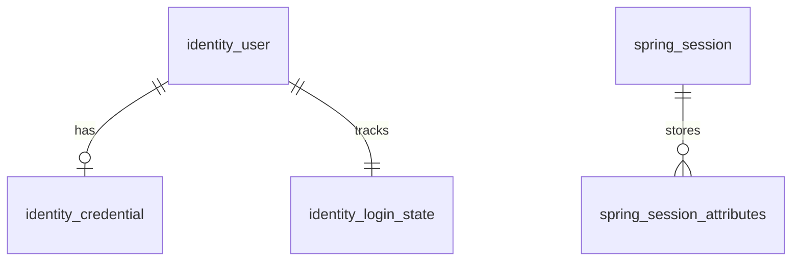

# Staff Authentication Database Design with Server-Side Sessions

Status: R3 design. JPA mappings exist for `identity_user`, `identity_credential`,
and `identity_login_state`, with offline PostgreSQL metadata/DDL checks. The SQL
below is not a Flyway migration and has not been run against PostgreSQL. No
dependencies have been added and authentication/session support is not implemented.

Requested scope: username/password over HTTPS, credential and status checks,
session issuance, identification of subsequent requests, and logout of the
current session. Roles, permissions, and RBAC tables belong to the later
authorization step. Completing authentication does not automatically grant
access to business APIs.

This design narrows the [overall proposal](auth-session-schema-proposal.md) to
staff authentication while retaining the existing identity conventions.

## 1. Business Workflow and Boundaries

| Step | Behavior | Data used |
| --- | --- | --- |
| 1 | A staff member submits a username/password over HTTPS | Normalize the username for lookup; never store the raw password |
| 2 | Spring Security checks the password and login conditions | Identity, credential, staff eligibility, and temporary lockout state |
| 3 | Complete authentication, then issue a session and cookie | Session store and minimal security context |
| 4 | Receive the cookie, validate the session, and identify the staff member | Session, identity status, security version, and staff eligibility |
| 5 | Log out the current session | Invalidate the server-side session, clear the cookie, and record audit evidence |

Section 6 of `SECURITY.md` requires MFA for staff. Step 3 therefore completes
only after the required MFA and credential conditions are satisfied. A correct
password with outstanding MFA or a required password change permits only a
restricted authentication flow. A pre-authentication session for CSRF/MFA is
not a fully authenticated staff session; rotate the session ID when
authentication completes.

Auth owns identities and credentials. Staff owns employee profiles, identifiers,
and employment eligibility. Auth uses a narrow application contract to check
staff eligibility; it must not call staff repositories or update staff tables.
That contract is not implemented yet. An existing identity alone does not prove
that the staff member remains eligible.

The staff flow accepts only `owner_type = 'STAFF'`. Retain the shared design's
`owner_type` and `owner_id` structure rather than creating a duplicate identity
model for staff. Whether an owner may have one or multiple identities remains
a business decision; this draft does not impose uniqueness on
`(owner_type, owner_id)`.

## 2. Tables and Relationships

Four core tables support identity, credentials, and sessions. Two supporting
tables hold login state and mandatory audit evidence; they are not role or
permission catalogs.

| Table | Owner | Purpose |
| --- | --- | --- |
| `identity_user` | Auth | Who logs in, the staff owner, and current status |
| `identity_credential` | Auth | Password hash and conditions for password use |
| `spring_session` | Spring Session JDBC | Sessions and their lifetimes |
| `spring_session_attributes` | Spring Session JDBC | Security context and session attributes |
| `identity_login_state` | Auth | Failed-login tracking and temporary lockout shared across instances |
| `audit_event` | Shared audit capability | Evidence of login, logout, and security changes |



Provisioning creates `identity_user` and `identity_login_state` in the same
transaction. A pending identity may not yet have a credential. The login-state
FK only prevents orphan rows; the provisioning transaction and tests must prove
that every identity has login state. If state is unexpectedly missing, reject
login and report an internal error rather than assuming the user is unlocked.

The session-to-identity and identity-to-staff relationships are logical links
through stable identifiers, not artificial FKs in the diagram. Audit evidence
is independent and must not cascade with identity/session deletion.

## 3. `identity_user`: Login Identity

The following DDL is for a new table and follows the existing proposal. Do not
run it directly against a database containing `appuser` or migration history
that has not been reconciled.

```sql
create table identity_user (
    id bigint generated always as identity primary key,
    public_id uuid not null,
    username varchar(100) not null,
    username_normalized varchar(100) collate "C" not null,
    owner_type varchar(16) not null,
    owner_id uuid not null,
    status varchar(32) not null default 'PENDING_ACTIVATION',
    security_version bigint not null default 0,
    created_at timestamptz not null default current_timestamp,
    updated_at timestamptz not null default current_timestamp,
    version bigint not null default 0,
    constraint uq_identity_user_public_id unique (public_id),
    constraint uq_identity_user_username unique (username_normalized),
    constraint ck_identity_user_username check (length(btrim(username)) > 0),
    constraint ck_identity_user_username_normalized check (
        username_normalized ~ '^[a-z0-9._@+-]+$'
        and username_normalized = lower(btrim(username) collate "C")
    ),
    constraint ck_identity_user_owner_type check (
        owner_type in ('CUSTOMER', 'STAFF')
    ),
    constraint ck_identity_user_status check (
        status in ('PENDING_ACTIVATION', 'ACTIVE', 'DISABLED')
    ),
    constraint ck_identity_user_security_version check (security_version >= 0),
    constraint ck_identity_user_version check (version >= 0)
);

create index ix_identity_user_owner on identity_user (owner_type, owner_id);
```

- `id`: internal `Long` for FKs; `public_id`: UUID used by APIs and as a stable
  principal reference. UUIDs do not replace access controls.
- `owner_id`: the UUID in the staff public contract. Do not assume that the
  corresponding staff table/schema already exists. A single FK cannot
  conditionally reference two modules.
- `username_normalized`: the globally unique lookup value in the current draft.
  The proposal uses trimming, lowercase with `Locale.ROOT`, and the ASCII
  character set in the DDL. Provisioning and login must use the same rules.
  Finalize this decision before implementation; do not implicitly extend it
  to Unicode or separate channel namespaces.
- `status`: `PENDING_ACTIVATION`, `ACTIVE`, or `DISABLED`. Only `ACTIVE` identities
  can complete login, and they must still pass credential, temporary-lockout,
  MFA, and staff-eligibility checks.
- `security_version`: the value captured by the session at authentication.
  Disabling an identity, resetting/changing its password, and security changes
  requiring revocation must increase this value in the same transaction as
  the change and audit. Subsequent requests reject sessions with older versions.
- `version`: optimistic locking for identity updates, distinct from the security
  version.

Do not put names, addresses, salaries, or HR profiles in auth. Do not store a
session ID on the user row: an identity may have multiple sessions under a
policy to be finalized later.

## 4. `identity_credential`: Password Credential

```sql
create table identity_credential (
    user_id bigint primary key,
    password_hash varchar(512) not null,
    password_changed_at timestamptz not null,
    must_change_password boolean not null default true,
    created_at timestamptz not null default current_timestamp,
    updated_at timestamptz not null default current_timestamp,
    version bigint not null default 0,
    constraint fk_identity_credential_user foreign key (user_id)
        references identity_user (id) on delete restrict,
    constraint ck_identity_credential_hash check (
        length(btrim(password_hash)) > 0
    ),
    constraint ck_identity_credential_version check (version >= 0)
);
```

`user_id` is both PK and FK: each identity has at most one current password
credential. Do not store plaintext or add a manually managed salt column.
`password_hash` holds the complete encoding produced by the approved password
encoder. Verify the 512-character limit against the actual encoder before
accepting the migration. In this flow, do not accept a client-supplied hash
as proof of authentication instead of the password.

`must_change_password = true` blocks full access until the password is changed
through an appropriately authenticated flow. Initial credential issuance,
activation, and recovery require a valid actor/proof; do not expose password
changes based only on a user ID. Do not impose periodic password expiration
without an established policy.

Passwords/hashes must not appear in session principals, public DTOs, logs, or
audit payloads. MFA-secret storage is not designed into this credential table.

## 5. Session Tables Managed by Spring Session JDBC

Take `org/springframework/session/jdbc/schema-postgresql.sql` from the exact
resolved artifact and include it in a new migration. The table below is a
reference contract, not confirmation of the runtime version. Do not create a
custom JPA entity or token/session ID.

| Table | Framework contract columns |
| --- | --- |
| `spring_session` | `primary_id char(36)` PK; `session_id char(36)` unique; `creation_time bigint`; `last_access_time bigint`; `max_inactive_interval integer`; `expiry_time bigint`; `principal_name varchar(100)` nullable |
| `spring_session_attributes` | `session_primary_id char(36)` FK; `attribute_name varchar(200)`; `attribute_bytes bytea`; PK `(session_primary_id, attribute_name)` |

Preserve the `expiry_time` and `principal_name` indexes and the attributes FK
with `ON DELETE CASCADE`. Session times use epoch milliseconds; do not change
them to business timestamp types.

Proposed application mapping: use `identity_user.public_id` as a string for the
principal index, explicitly configured and tested through Spring Session.
Sessions hold only the identity reference, security version captured at
authentication, authentication-completion time, and authentication level.
Do not store passwords/hashes or entire JPA entities.

`principal_name` is not an FK and does not create a principal automatically.
Spring Security must save and restore the security context through the framework.
Missing, incompatible, or non-deserializable attributes must cause session
rejection. Serialize only controlled types; do not accept arbitrary serialized
payloads from clients.

The cookie holds a framework-issued session ID, not a client-asserted staff ID.
Use appropriate `Secure`, `HttpOnly`, and `SameSite` settings, and protect both
login and logout with CSRF controls. Flyway owns the schema with
`spring.session.jdbc.initialize-schema=never`. Only the authenticated identity
from the security context may be used to return `/auth/me`.

The session manages idle timeout. Check absolute timeout separately from the
authentication time, without extending it indefinitely on each request.
Timeout policy and concurrent-session limits have not been chosen. Expired-session
cleanup is a background job whose schedule/database load must be documented
when implemented; delayed cleanup must not make expired sessions valid again.

## 6. `identity_login_state`: Failed Logins and Temporary Lockout

```sql
create table identity_login_state (
    user_id bigint primary key,
    failed_attempts integer not null default 0,
    failure_window_started_at timestamptz,
    last_failed_at timestamptz,
    locked_until timestamptz,
    last_authenticated_at timestamptz,
    created_at timestamptz not null default current_timestamp,
    updated_at timestamptz not null default current_timestamp,
    version bigint not null default 0,
    constraint fk_identity_login_state_user foreign key (user_id)
        references identity_user (id) on delete restrict,
    constraint ck_identity_login_state_failed_attempts check (failed_attempts >= 0),
    constraint ck_identity_login_state_failure_window check (
        (failed_attempts = 0 and failure_window_started_at is null)
        or (failed_attempts > 0 and failure_window_started_at is not null
            and last_failed_at is not null
            and last_failed_at >= failure_window_started_at)
    ),
    constraint ck_identity_login_state_version check (version >= 0)
);
```

`failed_attempts` counts failures within the current observation window; the
application handles window expiration. `locked_until` temporarily blocks login
and does not replace `status = 'DISABLED'`. Update `last_authenticated_at` only
after all required authentication steps complete. Successful authentication
resets the counter to 0 and the window to null in a controlled transaction.
Thresholds, lockout duration, MFA-failure counting, and unlock rules remain
policy decisions; no default values have been approved for release.

The PK supports lookup by user; indexes have not been added to every timestamp.
Application replicas share this data. Serialize updates per identity/login
state; do not use read-increment-save in a way that loses failures when two
requests arrive concurrently. Password-hash verification and MFA waiting must
not hold long-lived row locks. When recording the result, recheck status,
credential version, and security version to avoid issuing a session from a
stale authentication result.

This table does not prevent floods of nonexistent usernames or password
spraying across users. Before enabling login, implement shared rate limiting
with an appropriate source/scope, TTL, capacity bounds, and failure mode.
Do not store unbounded client-supplied usernames/IPs in the identity table.
Public errors must use safe messages that do not disclose whether a user
exists, is locked, or lacks credentials. Check timing differences through
the approved authentication provider/encoder as well.

## 7. `audit_event`: Reuse the Audit Contract

Use the [shared audit DDL](auth-session-schema-proposal.md#shared-audit-store-draft);
do not introduce role/permission tables or a separate audit table for each entity.

Required fields: `event_id`, `occurred_at`, `actor_type`, `actor_id`, `action`,
`target_type`, `target_id`, `outcome`, `reason_code`, `correlation_id`, and safe
metadata under the event schema. The minimum event contract covers successful
and failed login, temporary lockout, MFA, and logout. The actor may be unknown
for a failed login.

Do not record passwords, hashes, cookies, raw session IDs, OTP/MFA secrets, or
entire requests. The writer has insert permission only, without table ownership
or update/delete/truncate/DDL rights. Read access and retention use separate
identities and policies. Follow the referenced audit contract for indexes and
DDL; there is no cascading FK from audit to identity/session.

Audit evidence for identity/credential changes must share the transaction with
those changes. Failed-authentication counters/lockout state and audit require
a transaction that can commit even when HTTP access is denied. Do not roll back
evidence merely because an authentication exception is thrown.

Spring Session JDBC defaults to `REQUIRES_NEW` transactions, so do not assume
that sessions, audit, and counters commit atomically. The integration design
must prove that a valid authenticated session cannot remain when a mandatory
audit write fails. Return success only after context/session persistence and
audit succeed. Finalize transaction integration and test failure paths before
enabling login; do not catch failures and return success.

Logout invalidates the current server-side session and clears the cookie.
Repeating logout for an invalid session must not recreate it. If logout audit
fails, still prioritize session revocation, record the operational failure,
and do not report the whole operation as successful. If the session store
fails, clearing the cookie does not prove that the server-side session was
invalidated; report the error rather than claiming successful logout.
Logout-all is a separate command; current-session logout does not implicitly
revoke every session.

## 8. Conditions for Identifying Subsequent Requests

A request has an authenticated staff actor only when the session is valid, its
authentication level is sufficient, the identity is `ACTIVE`, owner type is
`STAFF`, staff eligibility is current, and the security version still matches.
Security checks require authoritative shared state, not only an old session
snapshot. Identity/session/staff lookup failure must deny access; it must not
allow anonymous access to protected APIs.

Do not select the actor from client-asserted staff/user IDs in headers or the
request body. Until authorization is implemented, do not expose business APIs
based only on `authenticated()`. The schema does not implement these checks.

## 9. Migrations, Verification, and Open Decisions

The user entity currently maps to `identity_user`, with an internal `Long` ID,
public UUID, and explicit status. Password data moved to
`IdentityCredentialJpaEntity`; temporary lockout belongs to
`IdentityLoginStateJpaEntity`. The `IdentitySession` placeholder was removed
because sessions use Spring Session JDBC. The `nonexpired`, `nonlocked`, and
`is_self_service_user` flags no longer represent the new state model.

The user confirmed that no local data needs preserving. Git shows that V1-V7
were deleted from source in commit `8cafe1c`; historical V6 created identity
tables with a different schema, including `owner_id bigint` and timestamps
without time zones. Therefore, do not treat the target schema as a compatible
V6 upgrade migration. The database's `flyway_schema_history` has not been
reconciled. Do not automatically restore or rewrite historical files, or restart
versioning at V1. The staff identity/eligibility contract is still missing.

During implementation, reconcile history before choosing a version. Add new
migrations; do not recreate `V1`, run repair/baseline, or edit applied migrations
without explicit direction. If `appuser` contains data, use an expand-and-migrate
plan preserving public UUIDs, references, and credential data. Do not infer
owners from `is_self_service_user` or invent precise timestamps from historical
dates. Business timestamps use `Instant` and `Clock`, with explicit
`updated_at` updates; SQL defaults apply only to inserts.

Deploy migrations before dependent code. Check locking, backfills, downtime,
and old/new writer compatibility on a synthetic database. Application rollback
requires compatibility; applied schemas remain unchanged and are corrected
through subsequent migrations. Reject stale sessions or incompatible contexts
on deployment rather than bypassing validation.

Before implementation, finalize username/namespace rules, identities per staff
member, password encoder, activation/provisioning proof, timeouts, session
limits, lockout/rate-limit policy, audit retention, and session/audit transaction
integration. MFA provider/enrollment/challenge/recovery and replay-resistant
storage require separate design. Do not store MFA secrets in the password table
or treat this document as a complete staff-login implementation.

Required implementation verification:

- Migrations on a synthetic database and mappings agree on types, nullability,
  defaults, indexes, and FKs. Duplicate usernames/public IDs, orphan credentials/
  state, and invalid statuses are rejected.
- Correct/incorrect passwords, nonexistent/pending/disabled identities,
  customer identities entering the staff flow, ineligible staff, missing
  credentials/state, and incomplete MFA.
- Concurrent failed logins do not lose counter updates; active lockouts are
  rechecked; concurrent disable/reset operations cannot issue sessions using
  stale credentials/versions.
- Session ID rotation, context round trips across instances, idle/absolute
  timeouts, cookie/CSRF controls, logout, and cookie replay after logout.
- Audit/counter rollback and commit follow the agreed boundaries; session/audit
  write failures, staff lookup failures, rate limiting for nonexistent users,
  and data redaction are covered.
- Session revocation after security changes, deployment compatibility, and
  identifier/reference preservation when legacy data exists.

Mapping verification: `AuthPersistenceMappingTest` builds Hibernate metadata
and DDL with the PostgreSQL dialect, checking credential separation, PKs/FKs,
unique username/public ID constraints, time types, optimistic locking, and
constraints against invalid data. This does not prove that PostgreSQL has
enforced those constraints. DDL, migrations, and authentication integration
tests have not been run; the database has not been changed.

No dependencies have been added. Implementing Spring Security/Session must
follow `LIBRARY.md` and verify the resolved versions. No financial data or
behavior is changed.

## References

- [SECURITY.md: authentication, audit, secrets](../../SECURITY.md)
- [CODING_STANDARD.md: domain, transaction, persistence](../../CODING_STANDARD.md)
- [Identity module design](identity-module-design.md)
- [Spring Session JDBC: schema and transactions](https://docs.spring.io/spring-session/reference/configuration/jdbc.html)
- [Spring Security: authentication persistence](https://docs.spring.io/spring-security/reference/servlet/authentication/persistence.html)
- [Spring Security: session management](https://docs.spring.io/spring-security/reference/servlet/authentication/session-management.html)
