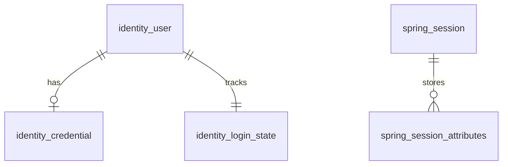

# Thiết kế DB: nhân viên đăng nhập bằng server-side session

Trạng thái: thiết kế risk R3; đã có JPA mapping cho `identity_user`,
`identity_credential`, `identity_login_state` và kiểm tra metadata/DDL PostgreSQL
không kết nối database. SQL dưới đây chưa phải Flyway migration và chưa chạy
trên PostgreSQL. Chưa thêm dependency hoặc triển khai authentication/session.

Phạm vi theo yêu cầu: username/password qua HTTPS, kiểm tra credential và
trạng thái, cấp session, nhận diện các request tiếp theo và logout phiên hiện
tại. Role, permission và các bảng RBAC thuộc bước authorization sau.
Authentication hoàn thành không tự cấp quyền truy cập API nghiệp vụ.

Thiết kế này thu hẹp [proposal tổng thể](auth-session-schema-proposal.md) vào
authentication cho staff, giữ convention identity hiện có.

## 1. Business và ranh giới

| Bước | Hành vi | Dữ liệu được dùng |
| --- | --- | --- |
| 1 | Nhân viên gửi username/password qua HTTPS | Chuẩn hóa username để lookup; không lưu password thô |
| 2 | Spring Security kiểm tra password và điều kiện đăng nhập | Identity, credential, staff eligibility, trạng thái khóa tạm |
| 3 | Hoàn tất xác thực rồi cấp phiên và cookie | Session store và security context tối thiểu |
| 4 | Nhận cookie, kiểm tra phiên và nhận diện nhân viên | Session, identity status, security version, staff eligibility |
| 5 | Logout phiên hiện tại | Vô hiệu session phía server, xóa cookie, ghi audit |

`SECURITY.md` mục 6 bắt buộc MFA cho nhân viên. Vì vậy bước 3 chỉ hoàn tất sau
MFA bắt buộc và các điều kiện credential. Đúng password nhưng còn thiếu MFA
hoặc phải đổi password chỉ được đi tiếp trong luồng xác thực hạn chế. Một
pre-authentication session phục vụ CSRF/MFA không phải phiên staff đã xác thực
đầy đủ; đổi session ID khi hoàn tất xác thực.

Auth sở hữu identity và credential. Staff sở hữu hồ sơ, định danh và điều kiện
làm việc của nhân viên. Auth dùng application contract hẹp để kiểm tra staff,
không gọi repository hoặc cập nhật bảng của staff. Contract này hiện chưa được
triển khai; không suy ra staff còn hợp lệ chỉ từ việc identity tồn tại.

Luồng staff chỉ chấp nhận `owner_type = 'STAFF'`. Giữ cấu trúc `owner_type` và
`owner_id` của thiết kế chung để không tạo thêm một bản sao identity cho staff.
Cardinality mỗi owner có một hay nhiều identity vẫn cần quyết định nghiệp vụ;
bản draft chưa áp đặt unique `(owner_type, owner_id)`.

## 2. Các bảng và quan hệ

Bốn bảng cốt lõi phục vụ identity/credential/session. Hai bảng hỗ trợ là trạng
thái đăng nhập và audit bắt buộc; chúng không phải catalog role/permission.

| Bảng | Sở hữu | Vai trò |
| --- | --- | --- |
| `identity_user` | Auth | Ai đăng nhập, thuộc staff nào, trạng thái hiện hành |
| `identity_credential` | Auth | Password hash và điều kiện sử dụng password |
| `spring_session` | Spring Session JDBC | Các phiên và thời hạn |
| `spring_session_attributes` | Spring Session JDBC | Security context và thuộc tính phiên |
| `identity_login_state` | Auth | Theo dõi lỗi đăng nhập và khóa tạm dùng chung giữa các instance |
| `audit_event` | Capability audit dùng chung | Bằng chứng login, logout và thay đổi bảo mật |



Provisioning tạo `identity_user` và `identity_login_state` trong cùng transaction.
Pending identity có thể chưa có credential. FK của login state chỉ chứng minh
không có dòng mồ côi; transaction và test provisioning phải chứng minh identity
luôn có login state. Khi thiếu state ngoài dự kiến, từ chối login và báo lỗi
nội bộ, không mặc định rằng user chưa bị khóa.

Liên kết session -> identity và identity -> staff là liên kết logic qua định
danh ổn định, không được biểu diễn thành FK giả trong diagram. Audit giữ bằng
chứng độc lập, không cascade theo identity/session.

## 3. `identity_user`: identity đăng nhập

DDL dưới đây dành cho bảng mới, dựa trên proposal hiện có. Không chạy trực tiếp
trên database có `appuser` hoặc lịch sử migration chưa được đối chiếu.

```sql
create table identity_user (
    id bigint generated always as identity primary key,
    public_id uuid not null,
    username varchar(100) not null,
    username_normalized varchar(100) collate "C" not null,
    owner_type varchar(16) not null,
    owner_id uuid not null,
    status varchar(32) not null default 'PENDING_ACTIVATION',
    security_version bigint not null default 0,
    created_at timestamptz not null default current_timestamp,
    updated_at timestamptz not null default current_timestamp,
    version bigint not null default 0,
    constraint uq_identity_user_public_id unique (public_id),
    constraint uq_identity_user_username unique (username_normalized),
    constraint ck_identity_user_username check (length(btrim(username)) > 0),
    constraint ck_identity_user_username_normalized check (
        username_normalized ~ '^[a-z0-9._@+-]+$'
        and username_normalized = lower(btrim(username) collate "C")
    ),
    constraint ck_identity_user_owner_type check (
        owner_type in ('CUSTOMER', 'STAFF')
    ),
    constraint ck_identity_user_status check (
        status in ('PENDING_ACTIVATION', 'ACTIVE', 'DISABLED')
    ),
    constraint ck_identity_user_security_version check (security_version >= 0),
    constraint ck_identity_user_version check (version >= 0)
);

create index ix_identity_user_owner on identity_user (owner_type, owner_id);
```

- `id`: `Long` nội bộ cho FK; `public_id`: UUID dùng trên API và làm tham chiếu
  principal ổn định. UUID không thay thế kiểm soát truy cập.
- `owner_id`: UUID trong contract public của staff; không mặc định rằng staff
  đã có table/schema tương ứng. Một FK không thể điều kiện hóa sang hai module.
- `username_normalized`: lookup duy nhất toàn hệ thống theo draft hiện có.
  Đề xuất trim, lowercase bằng `Locale.ROOT` và bộ ký tự ASCII nêu trong DDL;
  provisioning và login dùng cùng quy tắc. Đây là lựa chọn cần chốt trước khi
  triển khai, chưa tự mở rộng sang Unicode hoặc namespace riêng theo kênh.
- `status`: `PENDING_ACTIVATION`, `ACTIVE`, `DISABLED`. Chỉ `ACTIVE` mới có thể
  hoàn tất login, còn phải qua credential, khóa tạm, MFA và staff eligibility.
- `security_version`: giá trị phiên chụp lại khi xác thực. Disable, reset/change
  password và thay đổi bảo mật có tác dụng thu hồi phải tăng giá trị này cùng
  transaction và audit; request sau đó từ chối phiên mang version cũ.
- `version`: optimistic locking khi sửa identity, khác với security version.

Không đưa tên, địa chỉ, lương hoặc hồ sơ nhân sự vào auth. Không lưu session ID
trong dòng user: một identity có thể có nhiều phiên theo policy được chốt sau.

## 4. `identity_credential`: password credential

```sql
create table identity_credential (
    user_id bigint primary key,
    password_hash varchar(512) not null,
    password_changed_at timestamptz not null,
    must_change_password boolean not null default true,
    created_at timestamptz not null default current_timestamp,
    updated_at timestamptz not null default current_timestamp,
    version bigint not null default 0,
    constraint fk_identity_credential_user foreign key (user_id)
        references identity_user (id) on delete restrict,
    constraint ck_identity_credential_hash check (
        length(btrim(password_hash)) > 0
    ),
    constraint ck_identity_credential_version check (version >= 0)
);
```

`user_id` vừa là PK vừa là FK: mỗi identity tối đa một password credential hiện
tại. Không lưu plaintext hoặc thêm cột salt tự quản lý. `password_hash` giữ đầy
đủ encoding do password encoder được phê duyệt tạo ra; kiểm tra độ dài 512 với
encoder thực tế trước khi migration được chấp nhận. Không dùng hash từ client
làm bằng chứng đăng nhập thay cho password trong flow này.

`must_change_password = true` chặn truy cập đầy đủ cho tới khi đổi password qua
luồng được xác thực phù hợp. Việc cấp credential ban đầu, activation và recovery
cần actor/proof hợp lệ, không mở endpoint đổi password chỉ dựa vào user ID.
Không tự áp đặt chu kỳ hết hạn password khi policy chưa có.

Password/hash không xuất hiện trong session principal, DTO public, log hoặc
audit payload. Chưa thiết kế storage của MFA secret trong bảng credential này.

## 5. Hai bảng session do Spring Session JDBC quản lý

Lấy `org/springframework/session/jdbc/schema-postgresql.sql` từ đúng artifact
được resolve, đưa vào migration mới. Bảng dưới là hợp đồng tham chiếu, chưa xác
nhận version runtime. Không tạo JPA entity hoặc token/session ID riêng.

| Bảng | Các cột theo hợp đồng framework |
| --- | --- |
| `spring_session` | `primary_id char(36)` PK; `session_id char(36)` unique; `creation_time bigint`; `last_access_time bigint`; `max_inactive_interval integer`; `expiry_time bigint`; `principal_name varchar(100)` nullable |
| `spring_session_attributes` | `session_primary_id char(36)` FK; `attribute_name varchar(200)`; `attribute_bytes bytea`; PK `(session_primary_id, attribute_name)` |

Giữ index `expiry_time`, `principal_name` và FK attributes với `ON DELETE CASCADE`.
Session times theo epoch milliseconds; không đổi sang kiểu timestamp nghiệp vụ.

Mapping ứng dụng đề xuất: principal index là `identity_user.public_id` dạng
chuỗi, được cấu hình/test tường minh qua Spring Session. Session chỉ giữ tham
chiếu identity, security version tại thời điểm xác thực, thời điểm hoàn tất xác
thực và mức xác thực. Không giữ password/hash hay toàn bộ JPA entity.

`principal_name` không phải FK và không tự tạo ra principal. Spring Security
phải lưu/khôi phục security context đúng cơ chế framework. Thuộc tính bị thiếu,
không tương thích hoặc deserialize lỗi phải từ chối phiên. Chỉ serialize các
kiểu được kiểm soát; không nhận payload serialized tùy ý từ client.

Cookie giữ session ID do framework cấp, không chứa staff ID để client tự khai.
Cookie phải có `Secure`, `HttpOnly`, `SameSite` phù hợp; bảo vệ CSRF cả login và
logout. Flyway quản lý schema với `spring.session.jdbc.initialize-schema=never`.
Chỉ định danh đã xác thực từ security context mới được dùng để trả `/auth/me`.

Idle timeout do session quản lý; absolute timeout kiểm tra riêng từ thời điểm
xác thực, không gia hạn vô hạn theo mỗi request. Policy timeout và giới hạn số
phiên chưa được chọn. Cleanup phiên hết hạn là job nền cần ghi rõ lịch/tải DB
khi triển khai; cleanup chậm không được làm phiên hết hạn hợp lệ trở lại.

## 6. `identity_login_state`: lỗi đăng nhập và khóa tạm

```sql
create table identity_login_state (
    user_id bigint primary key,
    failed_attempts integer not null default 0,
    failure_window_started_at timestamptz,
    last_failed_at timestamptz,
    locked_until timestamptz,
    last_authenticated_at timestamptz,
    created_at timestamptz not null default current_timestamp,
    updated_at timestamptz not null default current_timestamp,
    version bigint not null default 0,
    constraint fk_identity_login_state_user foreign key (user_id)
        references identity_user (id) on delete restrict,
    constraint ck_identity_login_state_failed_attempts check (failed_attempts >= 0),
    constraint ck_identity_login_state_failure_window check (
        (failed_attempts = 0 and failure_window_started_at is null)
        or (failed_attempts > 0 and failure_window_started_at is not null
            and last_failed_at is not null
            and last_failed_at >= failure_window_started_at)
    ),
    constraint ck_identity_login_state_version check (version >= 0)
);
```

`failed_attempts` đếm lỗi trong cửa sổ đang xét; application xử lý khi cửa sổ
hết hạn. `locked_until` chỉ khóa tạm login, không thay `status = 'DISABLED'`.
`last_authenticated_at` chỉ cập nhật sau khi hoàn tất xác thực bắt buộc.
Successful authentication đặt counter về 0 và window về null trong transaction
được kiểm soát. Ngưỡng, thời gian khóa, cách tính lỗi MFA và quy tắc mở khóa là
policy còn phải chốt; chưa có con số mặc định để phát hành.

PK phục vụ lookup theo user; chưa thêm index vào mọi timestamp. Các replica app
dùng chung dữ liệu. Cập nhật phải serialize theo identity/login state, không
read-increment-save làm mất lỗi khi hai request đến đồng thời. Credential hash
check và chờ MFA không giữ row lock dài; khi ghi kết quả, recheck status,
credential version và security version để không cấp phiên từ kết quả đã cũ.

Bảng này không chống được flooding username không tồn tại hoặc password spraying
trên nhiều user. Trước khi mở login phải có rate limit dùng chung theo nguồn/
phạm vi phù hợp, TTL, giới hạn dung lượng và failure mode; không tự lưu vô hạn
username/IP do client gửi vào bảng identity. Lỗi public dùng thông điệp an toàn,
không tiết lộ user tồn tại, bị khóa hay chưa có credential; kiểm tra cả khác biệt
timing qua authentication provider/encoder được phê duyệt.

## 7. `audit_event`: dùng lại audit contract

Dùng [DDL audit dùng chung](auth-session-schema-proposal.md#shared-audit-store-draft),
không tạo bảng role/permission hoặc một bảng audit riêng cho mỗi entity.

Các trường cần thiết: `event_id`, `occurred_at`, `actor_type`, `actor_id`,
`action`, `target_type`, `target_id`, `outcome`, `reason_code`, `correlation_id`,
metadata an toàn theo schema sự kiện. Event contract tối thiểu gồm login thành
công/thất bại, khóa tạm, MFA và logout; login thất bại có thể không biết actor.

Không ghi password, hash, cookie, session ID thô, OTP/MFA secret hoặc toàn bộ
request. Writer chỉ insert, không sở hữu bảng, không update/delete/truncate/DDL;
read/retention có danh tính và policy riêng. Index và DDL theo contract audit
đã tham chiếu; không có FK cascade từ audit tới identity/session.

Audit cho thay đổi identity/credential phải cùng transaction với thay đổi đó.
Counter/lock và audit lần xác thực thất bại cần transaction có thể commit dù
HTTP trả từ chối; không rollback bằng chứng chỉ vì ném authentication exception.

Spring Session JDBC mặc định dùng transaction `REQUIRES_NEW`, nên không giả định
session, audit và counter tự commit nguyên tử. Thiết kế tích hợp phải chứng minh
không để phiên xác thực hợp lệ khi ghi audit bắt buộc thất bại; chỉ trả thành
công sau khi lưu context/session và audit thành công. Chốt transaction integration
và kiểm thử lỗi trước khi mở login, không catch rồi trả success.

Logout vô hiệu phiên hiện tại phía server và xóa cookie; logout lại phiên đã
hết hiệu lực không tái tạo phiên. Nếu audit logout lỗi vẫn phải ưu tiên thu hồi
phiên, ghi nhận lỗi vận hành và không báo toàn bộ thao tác thành công. Nếu kho
session lỗi, xóa cookie không chứng minh phiên server đã bị hủy; báo lỗi và
không tuyên bố đã logout thành công. Logout-all là command riêng, chưa mặc định
biến logout hiện tại thành thu hồi toàn bộ phiên.

## 8. Điều kiện nhận diện request tiếp theo

Một request chỉ có authenticated staff actor khi session còn hiệu lực, đủ mức
xác thực, identity `ACTIVE`, owner type `STAFF`, staff còn hợp lệ và security
version còn khớp. Security state cần authoritative shared state, không chỉ bản
snapshot cũ trong session. Identity/session/staff lookup lỗi thì từ chối truy
cập, không suy ra anonymous được phép đi vào API được bảo vệ.

Không đọc staff/user ID từ header tự khai hoặc body để chọn actor. Chưa làm
authorization thì chưa mở API nghiệp vụ chỉ bằng kiểm tra `authenticated()`.
Schema không tự triển khai các kiểm tra này.

## 9. Migration, kiểm chứng và các quyết định còn mở

Entity user hiện map `identity_user`, dùng ID nội bộ `Long`, public UUID và
trạng thái tường minh. Password đã chuyển sang `IdentityCredentialJpaEntity`;
khóa tạm thuộc `IdentityLoginStateJpaEntity`. Placeholder `IdentitySession` đã
bỏ vì session theo Spring Session JDBC. Các cờ `nonexpired`, `nonlocked`,
`is_self_service_user` không còn là mô hình trạng thái mới.

Người dùng xác nhận local không có dữ liệu cần giữ. Git cho thấy V1-V7 đã bị xóa
khỏi source tại commit `8cafe1c`; V6 lịch sử đã tạo identity tables với schema
khác (bao gồm `owner_id bigint` và các timestamp không có timezone). Do đó không
coi schema đích dưới đây là migration nâng cấp tương thích V6. Chưa đối chiếu
`flyway_schema_history` của database; không tự khôi phục, đổi nội dung các file
lịch sử hoặc chọn lại V1. Staff contract định danh/eligibility vẫn chưa có.

Khi triển khai: đối chiếu lịch sử trước khi chọn version; thêm migration mới,
không tự tạo lại `V1`, repair/baseline hoặc sửa migration đã áp dụng. Nếu có
`appuser` có dữ liệu, dùng kế hoạch expand-and-migrate giữ UUID public, reference
và dữ liệu credential. Không suy đoán owner từ `is_self_service_user`, không
biến ngày lịch sử thành timestamp chính xác do tự bịa. Business timestamps dùng
`Instant`, `Clock` và cập nhật `updated_at` tường minh; SQL default chỉ cho insert.

Migration đi trước code phụ thuộc; kiểm tra lock, backfill, downtime và tính
tương thích writer cũ/mới trên DB synthetic. Rollback ứng dụng cần compatibility;
schema đã áp dụng giữ nguyên, sửa bằng migration tiếp theo. Phiên cũ hoặc context
không tương thích khi deploy phải bị từ chối thay vì bỏ qua validation.

Trước implementation cần chốt username/namespace, số identity mỗi staff, password
encoder, activation/provisioning proof, timeout, giới hạn phiên, lock/rate-limit
policy, retention audit và transaction integration session/audit. MFA provider/
enrollment/challenge/recovery và storage chống replay cần thiết kế riêng; không
cất secret MFA vào password table hoặc xem bản này là staff login đã hoàn chỉnh.

Kiểm chứng bắt buộc khi triển khai:

- Migration trên DB synthetic và mapping khớp kiểu, nullable, default, index/FK;
  duplicate username/public ID, orphan credential/state và invalid status bị chặn.
- Password đúng/sai, identity không tồn tại/pending/disabled, customer identity
  vào staff flow, staff không hợp lệ, credential/state thiếu và MFA chưa xong.
- Hai login lỗi đồng thời không mất counter; khóa đang hiệu lực được kiểm tra
  lại; disable/reset đồng thời không tạo phiên sử dụng credential/version cũ.
- Session ID rotation, context round-trip qua nhiều instance, idle/absolute
  timeout, cookie/CSRF, logout và replay cookie sau logout.
- Audit/counter rollback và commit theo boundary đã chốt, lỗi ghi session/audit,
  lỗi staff lookup, rate limit với user không tồn tại và redaction dữ liệu.
- Thu hồi phiên sau thay đổi bảo mật, tương thích deployment và preservation
  identifier/reference nếu có dữ liệu legacy.

Kiểm tra mapping: `AuthPersistenceMappingTest` tạo Hibernate metadata và DDL theo
PostgreSQL dialect, kiểm tra tách credential, PK/FK, unique username/public ID,
kiểu thời gian, optimistic locking và constraint cho dữ liệu không hợp lệ.
Đây không phải bằng chứng PostgreSQL đã thực thi các constraint. Chưa chạy DDL,
migration hoặc authentication integration test; chưa thay đổi database.

Chưa thêm dependency; triển khai Spring Security/Session phải theo `LIBRARY.md`
và xác minh version thực tế. Không thay đổi dữ liệu hoặc hành vi tài chính.

## Nguồn đối chiếu

- [SECURITY.md: authentication, audit, secrets](../../SECURITY.md)
- [CODING_STANDARD.md: domain, transaction, persistence](../../CODING_STANDARD.md)
- [Identity module design](identity-module-design.md)
- [Spring Session JDBC: schema và transaction](https://docs.spring.io/spring-session/reference/configuration/jdbc.html)
- [Spring Security: persistence của authentication](https://docs.spring.io/spring-security/reference/servlet/authentication/persistence.html)
- [Spring Security: session management](https://docs.spring.io/spring-security/reference/servlet/authentication/session-management.html)
